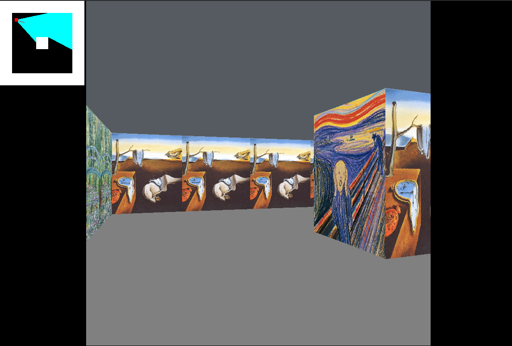

# cub3D (42)



Un petit moteur de raycasting (projet 42) écrit en C. Le but est d'implémenter un rendu 3D basique façon Wolfenstein 3D, avec textures, minimap et contrôle au clavier/souris.

## Fonctionnalités

- Rendu 3D par raycasting
- Textures pour les murs
- Minimap et affichage du joueur
- Contrôles clavier et souris

## Prérequis

- Linux (X11)
- gcc (ou cc) et make
- Bibliothèques X11 (libX11, libXext), libm, zlib
- La mini-lib `mlx` est fournie dans le répertoire `mlx/` (Makefile déjà configuré)

## Compilation

À la racine du projet, lancez :

```
make
```

Le binaire généré s'appelle `cub3D`.

## Exécution

Lancez le programme en lui donnant en argument un fichier map `.cub` présent dans le dossier `maps/`.

Exemple :

```
./cub3D maps/basic.cub
```

## Maps fournies

Le dossier `maps/` contient plusieurs exemples (`basic.cub`, `ok.cub`, `maze.cub`, ...). Utilisez-les pour tester le rendu et les textures.

## Contrôles (standard)

- Déplacement : WASD ou flèches
- Rotation / orientation : souris ou touches (selon configuration)
- Echappement / fermeture : ESC

Consultez `srcs/hooks/` pour la liste exacte des touches implémentées.

## Image de visualisation

Le fichier `cub3d.png` est référencé en haut du README pour un aperçu visuel. Si l'image n'apparaît pas :

1. Placez `cub3d.png` à la racine du dépôt (même dossier que ce `readme.md`).
2. Vous pouvez aussi créer un dossier `assets/` et mettre l'image dedans, puis mettre à jour la balise Markdown en conséquence.

Si vous voulez que j'ajoute une image de démonstration (placeholder), dites-le moi et je peux en créer une simple ou ajouter une notice pour l'ajouter dans le dépôt.

## Debug / Tests rapides

- Pour tester rapidement sans souris, utilisez les maps simples (`basic.cub`, `ok.cub`).
- Vérifiez les erreurs de parsing éventuelles affichées dans la console.

## Auteur

Lacuey David
